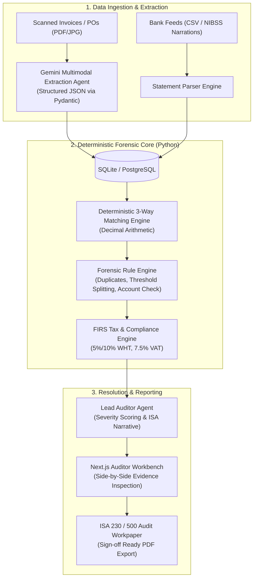

# AuditaAI — System Architecture & Engineering Development Plan

**Project:** AuditaAI (Autonomous Multi-Agent Enterprise Financial Auditing Platform)  
**Track:** AI-Powered Transaction Investigation & Resolution (Zenith Bank Zecathon 6.0)  
**Core Objective:** Replace 5% manual sampling with 100% continuous transaction auditing using Gemini multimodal perception, deterministic decimal reconciliation, and automated forensic exception resolution.

---

## 1. Goal Description

Traditional audits manually inspect only 5%–10% of transactions, missing unrecorded fraud and tax violations. AuditaAI ingests unstructured invoices, receipts, purchase orders, and core banking statements (CSV with NIBSS narrations), performs deterministic 3-way matching, runs forensic rule engines against 100% of disbursements, and generates verifiable ISA 230 / 500 audit workpapers with side-by-side evidence citations.

This document establishes the end-to-end technical blueprint, folder structure, data contracts, and execution milestones for the 4-member team across **Pre-Sprint (Oct 14–19)** and the **Live Hackathon (Oct 20–22)**.

---

## 2. Technical Safeguards & Principles

> [!IMPORTANT]
> **Zero Math Hallucination Architecture**:
> In accordance with our application commitments, Google Gemini multimodal models will **never** perform financial arithmetic. Gemini is restricted to unstructured document OCR and semantic field extraction into strict Pydantic schemas. All matching, totals, tolerance checks, and FIRS tax calculations are executed exclusively by a deterministic Python engine using `Decimal` precision.

> [!WARNING]
> **The 5 Ground-Truth Seeded Exception Cases**:
> The system's live hackathon success criteria hinges on detecting and resolving five specific seeded fraud/error cases within our 60-transaction dataset. In test-driven fashion, these five tests must be written and failing *before* building the detection pipelines.

---

## 3. The 5 Seeded Exception Test Cases (Ground Truth)

The synthetic dataset consists of **60 realistic corporate disbursements** with exactly **5 seeded exceptions** that the auditor workbench must flag and resolve:

| Case ID | Exception Category | Description | Ground Truth Detection Rule |
| :--- | :--- | :--- | :--- |
| **CASE-01** | **Duplicate Voucher Scheme** | Invoice `#INV-2026-089` paid twice. Second voucher has slightly tweaked ID (`#INV-2026-089B`) and date shifted by 4 days, but identical vendor and exact amount (`₦4,250,000`). | Fuzzy string match on Vendor + identical `Decimal` amount within a 30-day window. |
| **CASE-02** | **Approval Threshold Splitting** | Three consecutive disbursements of `₦985,000`, `₦970,000`, and `₦995,000` to the same consultant within 48 hours to circumvent the `₦1,000,000` CFO approval limit. | Window aggregation rule: Sum of disbursements to same vendor within 72 hours where each transaction is $< \text{threshold}$ but total exceeds limit. |
| **CASE-03** | **Vendor Account Diversion Fraud** | Invoice bank details (Account `1019283746`) do not match the verified Vendor Master database record (`2039485712`), indicating account redirection fraud before settlement. | Exact match check between invoice extracted account number and pre-approved Vendor Master table. |
| **CASE-04** | **Unapplied Withholding Tax (FIRS)** | Consultancy invoice of `₦8,500,000` paid in gross without deducting statutory 5% (or 10%) Withholding Tax, exposing the company to FIRS non-compliance penalties. | Deterministic tax engine check: Verifies `gross_amount - (tax_rate * gross_amount) == net_settlement_amount` based on expense category. |
| **CASE-05** | **Ghost Vendor / Unmatched Debit** | Bank debit of `₦3,750,000` to "Apex Supplies Ltd" appears in the bank ledger with zero matching Purchase Order and no valid invoice on file. | 3-Way Match failure: Bank debit exists in ledger with no linked PO or Invoice record. |

---

## 4. Multi-Agent Pipeline & Data Contracts



### Strict Pydantic Data Contract (Extraction Schema)
```python
from pydantic import BaseModel, Field
from decimal import Decimal
from typing import List, Optional
from datetime import date

class LineItemSchema(BaseModel):
    description: str
    quantity: Decimal
    unit_price: Decimal
    total: Decimal

class ExtractedInvoiceSchema(BaseModel):
    invoice_number: str
    invoice_date: date
    vendor_name: str
    vendor_tin: Optional[str] = None
    bank_name: Optional[str] = None
    account_number: Optional[str] = None
    subtotal: Decimal
    vat_amount: Decimal = Field(default=Decimal("0.00"))
    wht_deducted: Decimal = Field(default=Decimal("0.00"))
    total_amount: Decimal
    line_items: List[LineItemSchema] = []
    confidence_score: float
```

---

## 5. Target Codebase Architecture & File Layout

```
AuditaAI/
├── AuditaAI_Development_Plan.md            # Technical blueprint & execution plan
├── AuditaAI_Pitch_Deck.html                # Presentation slide deck
├── Zecathon_Form_Answers.md                # Official application submission content
├── README.md                               # Project overview and navigation
├── backend/                                # FastAPI & Python Forensic Core
│   ├── app/
│   │   ├── __init__.py
│   │   ├── main.py                         # FastAPI application entrypoint
│   │   ├── config.py                       # Environment settings & Gemini API keys
│   │   ├── database.py                     # SQLite engine & session management
│   │   ├── models/                         # SQLAlchemy database models
│   │   │   ├── invoice.py
│   │   │   ├── purchase_order.py
│   │   │   ├── bank_transaction.py
│   │   │   ├── vendor_master.py
│   │   │   ├── exception_item.py
│   │   │   └── workpaper.py
│   │   ├── schemas/                        # Pydantic data contracts
│   │   │   ├── extraction.py
│   │   │   ├── reconciliation.py
│   │   │   └── exception.py
│   │   ├── core/                           # Deterministic calculation engines
│   │   │   ├── decimal_math.py             # Precise arithmetic & tolerance checks
│   │   │   ├── nibss_parser.py             # Regex parser for Nigerian bank narrations
│   │   │   └── tax_calculator.py           # FIRS WHT (5/10%) & VAT schedules
│   │   ├── agents/                         # Agent pipelines
│   │   │   ├── extractor_agent.py          # Gemini Multimodal OCR caller
│   │   │   ├── matcher_engine.py           # 3-Way Reconciliation Core
│   │   │   ├── forensic_engine.py          # Duplicates, Benford's Law, split limits
│   │   │   └── lead_auditor_agent.py       # ISA workpaper narrative synthesizer
│   │   └── api/                            # REST Endpoints
│   │       ├── ingest.py                   # File & CSV upload endpoints
│   │       ├── audit.py                    # Trigger full audit execution
│   │       ├── exceptions.py               # Exception queue (Hold, Query, Escalate, Resolve)
│   │       └── reports.py                  # Export ISA 230 PDF / JSON workpapers
│   ├── data/                               # Synthetic Dataset & Ground Truth
│   │   ├── synthetic_bank_statements.csv   # 60 transactions
│   │   ├── synthetic_pos.json
│   │   ├── vendor_master.json
│   │   └── sample_invoices/                # Mock invoice images & PDFs
│   ├── tests/                              # Automated Test Suite
│   │   ├── test_seeded_cases.py            # Fails until the 5 fraud cases are caught
│   │   ├── test_decimal_math.py            # Zero-hallucination arithmetic tests
│   │   └── test_tax_engine.py              # FIRS withholding tax checks
│   ├── requirements.txt
│   └── run.py
└── frontend/                               # Next.js 14 / Tailwind / React
    ├── src/
    │   ├── app/
    │   │   ├── layout.tsx                  # Executive dark theme shell (Matching Pitch Deck)
    │   │   ├── page.tsx                    # Executive Overview: KPIs, Risk Exposure, Match Rate
    │   │   ├── exceptions/
    │   │   │   ├── page.tsx                # Exception Queue (Severity badges, quick filters)
    │   │   │   └── [id]/page.tsx           # Side-by-Side Evidence Inspection Workbench
    │   │   ├── upload/page.tsx             # Document Dropzone (Invoices, POs, Statements)
    │   │   └── workpaper/page.tsx          # ISA 230 Workpaper Preview & Print-Ready PDF
    │   ├── components/
    │   │   ├── KpiStats.tsx                # 100% Audit Coverage, Total Leakage, Clean Matches
    │   │   ├── ExceptionTable.tsx          # Filterable, sortable anomaly queue
    │   │   ├── SideBySideViewer.tsx        # Original PDF / Mock scan alongside Bank record
    │   │   ├── BenfordChart.tsx            # First-digit distribution vs Benford curve
    │   │   └── WorkpaperExport.tsx         # Sign-off ready formal audit document
    │   └── lib/
    │       ├── api.ts                      # Backend API client
    │       └── formatters.ts               # Naira formatting (₦), dates, percentages
    ├── package.json
    └── tailwind.config.js
```

---

## 6. 4-Member Team Work Breakdown Structure (WBS)

### Phase 1: Pre-Sprint (October 14 – 19)

#### Member 1: AI & Agentic Orchestration Lead
* [ ] Set up Google Gemini API client with structured outputs (`response_schema=ExtractedInvoiceSchema`).
* [ ] Create system prompts for multimodal document extraction (ensuring confidence scoring and line item breakdown).
* [ ] Write fallback parser mock for offline/local hackathon demo resiliency.
* [ ] Implement prompt templates for the **Lead Auditor Agent** (generating ISA-compliant finding descriptions and corrective action suggestions).

#### Member 2: Backend & Forensics Engine Lead
* [ ] Scaffold FastAPI app, SQLite database, and SQLAlchemy models.
* [ ] Implement `core/decimal_math.py` ensuring zero floating-point arithmetic errors.
* [ ] Write `tests/test_seeded_cases.py` containing the 5 ground-truth test assertions (ensuring tests fail initially).
* [ ] Implement deterministic 3-way matching engine (`matcher_engine.py`) and threshold splitting detector.

#### Member 3: Frontend & UI/UX Lead
* [ ] Initialize Next.js 14 app with Tailwind CSS and *Plus Jakarta Sans* font stack.
* [ ] Build the layout shell matching the executive slate and Zenith crimson aesthetic of the pitch deck.
* [ ] Implement Executive Dashboard KPIs (Clean Match Rate, Total Exposure ₦, Active Exceptions).
* [ ] Build the Exception Table with risk severity badges (`Critical`, `High`, `Medium`, `Info`).

#### Member 4: Domain, Compliance & Dataset Lead
* [ ] Generate the **60-transaction synthetic dataset**:
  * 55 clean disbursements (perfect 3-way match, valid tax, matching vendor accounts).
  * 5 seeded exception cases (Duplicate, Split Threshold, Diverted Account, Missing WHT, Ghost Debit).
* [ ] Create realistic mock invoice PDFs and receipt images corresponding to the dataset.
* [ ] Curate the `vendor_master.json` table with verified Nigerian corporate entities and bank account details.
* [ ] Document exact FIRS tax withholding rates (5% on construction/supplies, 10% on professional/consultancy fees).

---

### Phase 2: Live Hackathon Build Sprint (October 20 – 22, 48 Hours)

* **Sprint Day 1 (Oct 20): Ingestion & Matching**
  * Wire file upload endpoints to Gemini extraction pipeline.
  * Connect CSV statement parser to SQLite database.
  * Execute deterministic 3-way matching over the 60 transactions.
* **Sprint Day 2 (Oct 21): Forensics & Resolution Workflow**
  * Run the forensic engine and verify all 5 seeded fraud cases trigger automatically.
  * Build the **Side-by-Side Evidence Inspection Workbench** in the frontend (invoice scan displayed adjacent to bank ledger debit with highlighted discrepancy).
  * Implement auditor actions: `[Hold Payment]`, `[Query Vendor]`, `[Request WHT Adjustment]`, `[Escalate to Inspection]`.
* **Sprint Day 3 (Oct 22): ISA Workpaper & Demo Rehearsal**
  * Implement the ISA 230 / 500 Audit Workpaper generation and PDF export.
  * Execute end-to-end dry run: Upload files $\rightarrow$ Live Processing $\rightarrow$ Exception Detection $\rightarrow$ Resolution $\rightarrow$ Workpaper Sign-off.

---

## 7. Verification Plan

### Automated Tests
1. **Zero Math Hallucination Test**:
   ```bash
   pytest backend/tests/test_decimal_math.py
   ```
2. **Seeded Exception Detection Test**:
   ```bash
   pytest backend/tests/test_seeded_cases.py
   ```
3. **Tax Compliance Calculation Test**:
   ```bash
   pytest backend/tests/test_tax_engine.py
   ```

### Manual Verification Flow
1. **Upload Dataset:** On the `/upload` page, drop in the synthetic 60-transaction bank statement CSV and the invoice bundle.
2. **Execute Audit:** Click "Run Autonomous Audit". Observe the visual progress indicators across the 5 agents.
3. **Inspect KPI Dashboard:** Verify that 55 transactions show "Clean Match (91.7%)", while 5 are flagged under "Active Exceptions (₦18,450,000 at risk)".
4. **Drill Down into Evidence:** Click on `CASE-03` (Vendor Account Diversion). Verify that the original invoice image appears on the left with the fraudulent account highlighted, alongside the verified Vendor Master record on the right.
5. **Take Action:** Click "Hold Payment & Flag for Inspection".
6. **Export Workpaper:** Navigate to `/workpaper`, verify that the formal ISA 230 memorandum lists all 5 exceptions, their evidence citations, and click "Print / Export Workpaper".
