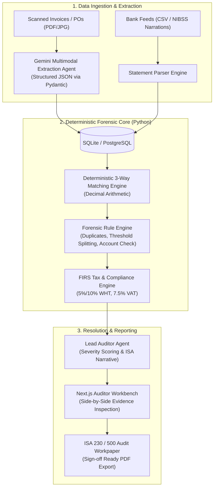

# AuditaAI: Autonomous Multi-Agent Financial Auditing Platform

> **AuditaAI** transitions enterprise and financial institution audits from 5% manual sampling to **100% continuous, real-time transaction investigation**.

---

## 📌 Project Overview

Traditional financial audits rely on 5%–10% manual sampling conducted months after funds have settled. In the African commercial ecosystem, invoices and receipts arrive as unstructured paper scans and PDFs, while payments sit in core bank ledgers (NIBSS / Zenith bank feeds).

**AuditaAI** solves this through a multi-agent auditing pipeline:
1. **Multimodal Perception (Google Gemini):** Extracts structured line items, dates, vendor Tax IDs (TIN), and bank account details from messy scanned receipts and invoices.
2. **Deterministic 3-Way Matching Engine:** Zero-hallucination arithmetic in Python (`Decimal`) comparing Purchase Orders, Invoices, and Bank Debits.
3. **Forensic Rule Engine:** Detects duplicate vouchers, approval-threshold splitting schemes, vendor account redirection fraud, and unapplied Withholding Tax (FIRS WHT / VAT).
4. **Resolution & ISA Workpapers:** Side-by-side evidence workbench with one-click export to formal ISA 230 / 500 audit workpapers.

---

## 📂 Repository Contents & Plans

This repository contains the complete submission plans and engineering architecture for AuditaAI:

* 📄 **[AuditaAI_Development_Plan.md](./AuditaAI_Development_Plan.md)**  
  *End-to-end technical blueprint, system architecture, strict Pydantic schemas, 5 seeded fraud cases (ground truth), automated test plans, and the 4-person sprint breakdown.*

* 📊 **[AuditaAI_Pitch_Deck.html](./AuditaAI_Pitch_Deck.html)**  
  *Executive 8-slide pitch presentation built with modern Tailwind CSS and vector icons. Includes interactive presentation mode and print-to-PDF layout.*

* 📝 **[Zecathon_Form_Answers.md](./Zecathon_Form_Answers.md)**  
  *Word-count-verified official application answers submitted to the Zenith Bank Zecathon 6.0 portal.*

---

## 🏗️ System Architecture

---

## 🛡️ Key Architectural Principles

* **Zero Math Hallucination:** Language models are strictly barred from performing financial calculations. Gemini handles semantic perception; all matching, sums, and tax percentages run in Python `Decimal`.
* **Test-First Fraud Ground Truth:** The 5 seeded fraud/error cases (Duplicate Voucher, Threshold Splitting, Account Diversion, Unapplied WHT, Ghost Debit) are codified as failing unit tests before detectors are implemented.
* **African Banking Specifics:** Native support for Nigerian NIBSS bank transaction narrations, FIRS Withholding Tax schedules, and localized vendor workflows.

---

## 👥 4-Member Team Roles

* **Member 1 (AI & Agentic Lead):** Multimodal document extraction schemas, prompt engineering, agent orchestration.
* **Member 2 (Backend & Forensic Engine Lead):** FastAPI core, deterministic 3-way matching, Benford's Law and statistical outlier engines.
* **Member 3 (Frontend & UX Lead):** Next.js auditor dashboard, side-by-side evidence workbench, exception queues.
* **Member 4 (Domain, Compliance & Pitch Lead):** FIRS/CBN regulatory schedules, synthetic dataset curation, pitch deck & live demo narrative.

---

## 🗓️ Hackathon Timeline

* **October 13, 2026:** Application Submission Deadline
* **October 14–19, 2026:** Pre-Sprint (Scaffolding, synthetic dataset curation, test-first harness)
* **October 20–22, 2026:** Live 48-Hour Hackathon Build Sprint
* **October 28, 2026:** Final Demo Day & Executive Pitch
